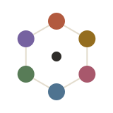

<div align="center">



# Personal OS

**Discipline, without the dopamine tricks.**

A free, self-hosted daily check-in for six areas of your life.<br />
No streaks, no points, no subscription, no cloud. A mirror, not a judge.

[](https://github.com/tombino104/PersonalOS/releases)
[](LICENSE)
[](https://github.com/tombino104/PersonalOS/actions/workflows/ci.yml)
[](https://tombino104.github.io/PersonalOS/)

**[Live demo](https://tombino104.github.io/PersonalOS/)** · **[Run it](#run)** · **[Features](#features)** · **[Plugins](docs/plugins.md)** · **[Changelog](CHANGELOG.md)**

<sub>The demo runs entirely in your browser with made-up data: nothing is sent anywhere.</sub>

<br />

</div>

https://github.com/user-attachments/assets/98feb118-1a01-480c-8f54-c3e1624246be

<div align="center">

<sub>The 49-second film. <a href="docs/media/personal-os.mp4">Download it</a>.</sub>

</div>

## A closer look

| | |
| --- | --- |
|  |  |
|  |  |
|  |  |

*Generated demo data.*

## Why

- **Free, really.** No paid tier, no ads. Open source (AGPL-3.0).
- **No toxic gamification.** No streaks, ranks or points to chase, no notifications tied to your score. A day you skip is empty, not a failure.
- **Pure discipline.** You note what you did, never what you achieved. A mirror, not a judge.
- **Your data, your machine.** One SQLite file, daily backups, no telemetry.

## Run

You need Docker.

```bash
docker compose up -d --build
```

Open `http://127.0.0.1:47213`. The first screen asks for a one-time setup code, which is in `data/setup-code.txt` (and in the container logs). Then the welcome screens end with the creation of your account.

The server listens on `127.0.0.1` only. To reach it from other devices, put it behind a reverse proxy or a private network such as Tailscale: it is not meant to face the public internet.

Prebuilt images (amd64 and arm64) are at `ghcr.io/tombino104/personalos`. [Run on umbrelOS](docs/umbrel.md) is supported too, through a community app store.

More about running it (settings, password reset, command line): [docs/running.md](docs/running.md).

## Features

- Six life areas, a few activities each, a relative score per area
- An evening questionnaire, with optional days of the week per activity and an optional time before which it stays closed
- Trends, a six-month heatmap, the "star" of the six areas, past reports, and a weekly review
- Habits by weekday, or with a goal of N times a week
- Plugins: calendar, mood tracker, journal, daily quote; [write your own](docs/plugins.md)
- Light and dark theme, English and Italian
- A dock you arrange yourself: up to seven pages, in the order you like
- Backups and restore from Settings, export to CSV and JSON, a built-in guide
- Installable on your phone like an app (PWA)

## Develop

Python 3.13+ (FastAPI, SQLite) and Node 24+ (Svelte 5, Vite).

```bash
python -m venv .venv
.venv/Scripts/pip install -r requirements-dev.txt   # Linux/macOS: .venv/bin/pip
.venv/Scripts/python -m pytest
cd web && npm install && npm test && npm run build
```

Contributions are welcome: see [CONTRIBUTING.md](CONTRIBUTING.md). Security issues: [SECURITY.md](SECURITY.md). Changes are listed in [CHANGELOG.md](CHANGELOG.md).

## License

Copyright (C) 2026 Lorenzo (tombino104). Released under the [GNU Affero General Public License v3.0](LICENSE). Versions up to v0.10.2 were published under PolyForm Noncommercial 1.0.0.
